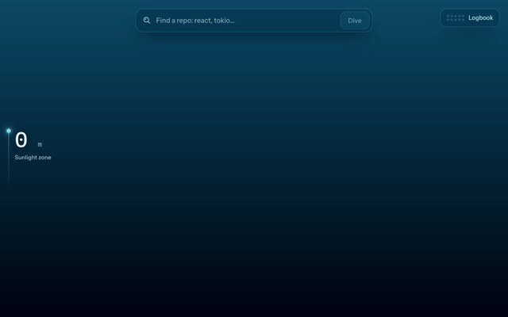

# Git Ocean

**GitHub is an ocean. Dive in.**



Git Ocean shows GitHub's open-source ecosystem as a living 3D ocean. Every repo is a creature. You can see how big, how alive and how neglected a project is before you read a single number.

- Search for a repo and the camera plunges to it.
- Drift around and click whatever glows.
- Find creatures caught in nets: projects with old, unanswered issues that need help.

Every dive has a shareable link (`/dive/owner/repo`) that replays the same plunge for whoever opens it.

## How to read the ocean

| You see | It means |
|---|---|
| **Size** | Stars, on a log scale. A 200K-star project is a whale, a new repo is a minnow |
| **Glow and speed** | Recent activity: last push and commits in the past 30 days. Bright, darting fish are alive right now; dim, drifting ones are dormant |
| **Colour (species)** | Primary language: Python blue, Rust peach, Go cyan, JavaScript yellow, TypeScript light blue, C grey, C++ navy, Ruby red, Java bronze. Everything else shares a muted sea-green |
| **Depth** | Fame, inverted. New and small repos live in the shallows; legends live in the abyss (~9,000m) |
| **Netting** | Issues open for more than 2 years with **zero comments**. A high issue count alone never nets a creature, because it usually means an active community |

The full rules live in [`PRD.md`](PRD.md) §5.

## Quick start

Requires Node 20+ and pnpm.

```bash
pnpm -C frontend install
pnpm dev            # http://localhost:5173
```

With no token, it runs on a **sample ocean** of illustrative repos (a footnote in the app says so). For live GitHub data, create `.env` in this folder:

```
GITHUB_TOKEN=ghp_…   # public read access is enough
```

Restart `pnpm dev` and it uses live data, with no code change. The token stays on the server and never reaches the browser.

| Command | What it does |
|---|---|
| `pnpm dev` | App plus the `/api/github` edge function, run locally |
| `pnpm test` | Unit tests (Vitest); GitHub is always mocked |
| `pnpm lint` | ESLint |
| `pnpm build` | Type-check and production build |

Browser checks for each user flow are in `frontend/e2e/`. See [`docs/TESTING.md`](docs/TESTING.md) for how to run them and for the manual test script.

## Controls

- **Search:** press `/`, type a repo name, then Enter to dive. Names that match nothing still land you on an "uncharted" creature.
- **Swim:** scroll, drag (touch), or use the arrow and Page Up/Down keys.
- **Inspect:** click or tap a creature to open its card. Escape closes it.
- **Logbook** (top right): species you've discovered, plus a keyboard- and screen-reader-friendly list of nearby creatures.
- Respects `prefers-reduced-motion`: the ocean holds still and dives cut instead of plunging.

## How it's built

Vite, React 18 and TypeScript, with Three.js through React Three Fiber, Zustand for state and React Router for links. The data comes from the GitHub GraphQL API through a Vercel edge function.

```
frontend/
  api/github.ts             edge function: GitHub proxy, caching, fallback to the last good batch, mock mode
  src/ocean/                canvas, camera, instanced creatures, GLSL shaders
  src/data/                 API client, mapRepoToCreature (the metaphor rules), fabricate, fixtures
  src/components/           search, Depth Compass, Info Card, Logbook
  src/store/oceanStore.ts   the single Zustand store
  e2e/                      Playwright checks for each flow
```

All creatures render in two instanced draw calls, and motion runs on the GPU. [`ARCHITECTURE.md`](ARCHITECTURE.md) explains why.

## Deploy

On Vercel, import the repo with **Root Directory = `frontend`** (`vercel.json` already sets the build and routing), add `GITHUB_TOKEN` as an environment variable, and deploy. `api/github.ts` deploys as an edge function automatically.

## Docs

- [`PRODUCT.md`](PRODUCT.md): who it's for and the product principles
- [`PRD.md`](PRD.md): full product spec
- [`ARCHITECTURE.md`](ARCHITECTURE.md): technical design
- [`docs/progress.md`](docs/progress.md): build status by phase
- [`docs/decisions.md`](docs/decisions.md): judgment calls made during the build
- [`docs/known-issues.md`](docs/known-issues.md): what's unverified or pending
